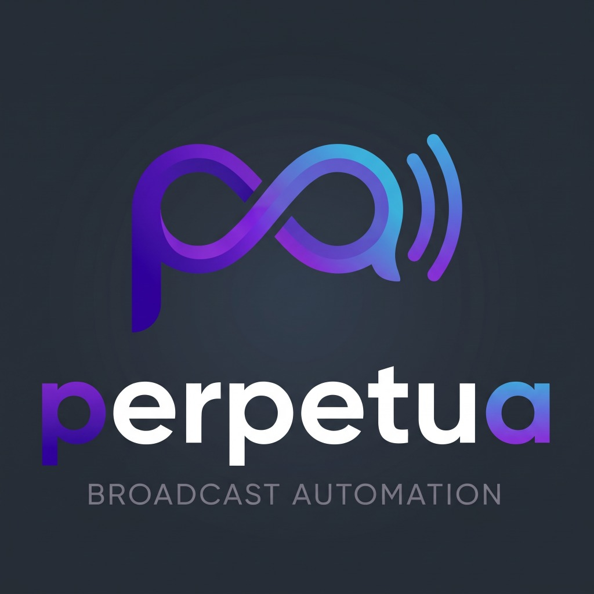

# Perpetua — Broadcast Automation Console

<p align="center">
  
</p>

<p align="center">
  <strong>Consola moderna y profesional de automatización radial y emisión en vivo</strong><br>
  Construida con <strong>Rust</strong>, <strong>Tauri v2</strong> y <strong>React 19</strong> para máxima estabilidad, baja latencia y consumo ultra ligero de memoria en <strong>Linux</strong> y <strong>Windows</strong>.
</p>

<p align="center">
  <a href="https://github.com/Antholl73/Perpetua-app/releases"></a>
  
  
  
  
</p>

---

## 📻 ¿Qué es Perpetua?

**Perpetua** es un software de automatización y continuidad de radiodifusión diseñado para emisoras de FM/AM, estaciones comunitarias, radios online y creadores de contenido que buscan la solidez operativa de las cabinas clásicas combinada con la agilidad y estética de las interfaces modernas.

A diferencia de los reproductores convencionales o de los programas legados de los años 2000, Perpetua está construido con una **arquitectura multihilo libre de bloqueos en Rust**, lo que garantiza que la emisión al aire nunca sufra cortes, congelamientos o micro-pausas.

### Características Principales

* 🎚️ **Ruteo de Audio Multitarjeta Físico (Aire / Cue):**
  Soporte nativo con `cpal` para asignar dos tarjetas físicas independientes: una para la salida principal al **Aire (Main Deck)** y otra para la **Preescucha (Cue/PFL)** de auriculares. Si el equipo solo dispone de una tarjeta de sonido, el sistema realiza una mezcla inteligente compartida automáticamente.
* ⚡ **Streaming en Tiempo Real (JIT) y Lazy Probing:**
  La importación de archivos de audio de cualquier tamaño es instantánea gracias a la inspección perezosa con `symphonia`. La decodificación se realiza en fragmentos (`chunks`) hacia un búfer circular lock-free (SPSC) en el momento exacto en que la pista pasa a reproducirse.
* 🎛️ **Botonera de Jingles Instantánea (Cart Machine):**
  9 ranuras de acceso directo mapeadas numéricamente (`1` al `9` en el teclado) para disparar ráfagas, identificativos o efectos sobre la emisión sin interrumpir la pista principal. Clic derecho para preescuchar en Cue o reasignar archivos.
* 📅 **Planificador de Eventos No Destructivos (Event Scheduler):**
  Reloj asíncrono con evaluación al segundo de eventos programados por hora (`HH:MM`) y días de la semana, con tres modos de interrupción:
  * **Ducking (Atenuación -70%):** Reduce suavemente el volumen de la música mientras suena el evento (cuña o mención) y lo restaura al 100% al terminar.
  * **Pausa y Reanuda:** Pausa la canción al frame exacto, reproduce el evento y reanuda la música justo donde se quedó.
  * **Espera al Final:** Coloca el evento en la cola prioritaria para que suene inmediatamente al concluir la canción actual.
* 📁 **Carpetas Aleatorias Inteligentes con Anti-Repeat (50 pistas):**
  Inserción de directorios completos como un único bloque en la lista. El motor selecciona una pista al azar y mantiene un historial en memoria de las últimas 50 canciones para garantizar que ninguna pista se repita en rotaciones cortas. Además, permite desplegar visualmente los archivos de la carpeta en la tabla sin cargarlos en memoria.
* 🕒 **Locuciones de Hora Virtuales (`.time`):**
  Comando virtual encadenado sin silencios que lee el reloj del sistema y pronuncia la hora actual secuenciando clips locales (`son_las.mp3` + `{HH}.mp3` + `{MM}.mp3`).
* 🎙️ **Sincronización Exacta de Pisadores (Sweeper Engine):**
  Disparo milimétrico de locuciones sobre el Intro de las canciones mediante la fórmula: `(Tiempo de Intro) - (Duración del Pisador)`. El pisador concluye exactamente en el instante en que entra la voz del cantante.
* 📊 **Editor Visual de Puntos de Mezcla (Forma de Onda a 60 FPS):**
  Modal interactivo que dibuja la envolvente PCM de la canción con telemetría bidireccional en vivo (`~20ms`), cursor de reproducción (Playhead) sincronizado, clic para saltar (**Seek**) y atajo rápido (<kbd>M</kbd> o <kbd>Intro</kbd>) para fijar el punto de entrada vocal.
* 💾 **Persistencia Universal:**
  Guardado y apertura de listas de emisión completas en formato estándar `.m3u8` / `.m3u` o `.json` estructurado, conservando modos de reproducción, tiempos de crossfade, metadatos y configuración de la botonera.

---

## 🚀 Guía de Instalación

Puedes instalar Perpetua descargando los ejecutables precompilados oficiales desde la sección de **[Releases](https://github.com/Antholl73/Perpetua-app/releases)** o compilando el código fuente en tu máquina.

---

### 🪟 Instalación en Windows

#### Método 1: Usando el Instalador Oficial `.exe` (Recomendado)

1. Ingresa a la sección de descargas: **[GitHub Releases de Perpetua](https://github.com/Antholl73/Perpetua-app/releases)**.
2. Descarga el instalador más reciente para Windows:
   * **`Perpetua_0.1.0_x64-setup.exe`**
3. Haz doble clic sobre el archivo descargado para ejecutar el instalador NSIS.
   > **Nota de Windows SmartScreen:**  
   > Al tratarse de una versión Alfa reciente, Windows Defender SmartScreen puede mostrar un aviso azul indicando *"Windows protegió su PC"*.  
   > Para continuar: haz clic en **«Más información»** y luego en el botón **«Ejecutar de todas formas»**.
4. Sigue las instrucciones del asistente (*Siguiente* → *Instalar*). El instalador:
   * No requiere permisos de administrador (se instala en el perfil del usuario actual).
   * Configura automáticamente el motor web Microsoft Edge WebView2.
   * Crea un acceso directo en tu **Escritorio** y en el **Menú Inicio**.
5. Abre **Perpetua** y comienza a emitir.

#### Método 2: Compilación manual desde código fuente en Windows

1. Instala los requisitos previos:
   * [Node.js LTS (v20 o superior)](https://nodejs.org/)
   * [Rust y Cargo (`rustup-init.exe`)](https://rustup.rs/)
   * [Visual Studio C++ Build Tools](https://visualstudio.microsoft.com/visual-cpp-build-tools/) (con la carga de trabajo *"Desarrollo para el escritorio con C++"* activada).
2. Clona el repositorio y entra a la carpeta:
   ```powershell
   git clone https://github.com/Antholl73/Perpetua-app.git
   cd Perpetua-app
   ```
3. Instala las dependencias y compila:
   ```powershell
   npm --prefix ui install
   npm --prefix ui run build
   cargo run -p perpetua-desktop
   ```
4. Para generar el instalador `.exe` distribuible:
   ```powershell
   cd crates/perpetua-desktop
   npx @tauri-apps/cli@latest build --bundles nsis
   ```
   El instalador se generará en `target\release\bundle\nsis\Perpetua_0.1.0_x64-setup.exe`.

---

### 🐧 Instalación en Linux

Perpetua está optimizado para Linux y funciona perfectamente sobre **PipeWire** y **ALSA**. Dispones de dos formatos de instalación según tu distribución:

---

#### Opción A: Paquete Portable `.AppImage` (Cualquier distribución Linux)

El formato AppImage es portable y no requiere instalación ni permisos de superusuario:

1. Ingresa a **[GitHub Releases](https://github.com/Antholl73/Perpetua-app/releases)** y descarga:
   * **`Perpetua_0.1.0_amd64.AppImage`**
2. Otorga permisos de ejecución al archivo:
   * **Desde la terminal:**
     ```bash
     chmod +x Perpetua_0.1.0_amd64.AppImage
     ```
   * **Desde el entorno gráfico:** Clic derecho sobre el archivo descargado → *Propiedades* → pestaña *Permisos* → marcar la casilla **«Permitir ejecutar el archivo como un programa»**.
3. Haz doble clic sobre el archivo `.AppImage` (o ejecuta `./Perpetua_0.1.0_amd64.AppImage` desde la terminal) para iniciar la aplicación de inmediato.

---

#### Opción B: Paquete Debian `.deb` (Ubuntu, Debian, Linux Mint, Pop!_OS)

1. Ingresa a **[GitHub Releases](https://github.com/Antholl73/Perpetua-app/releases)** y descarga:
   * **`Perpetua_0.1.0_amd64.deb`**
2. Instala el paquete a través de la terminal con `apt` (lo que resolverá dependencias automáticamente):
   ```bash
   sudo apt update
   sudo apt install ./Perpetua_0.1.0_amd64.deb
   ```
   *(También puedes hacer doble clic en el archivo descargado para abrirlo en la tienda de software o en GDebi).*
3. Al finalizar, busca **Perpetua** en el menú de aplicaciones de tu sistema o ejecuta `perpetua` en la terminal.

---

#### Opción C: Compilación manual desde código fuente en Linux

1. Instala las dependencias de compilación y librerías del sistema:
   * **Ubuntu / Debian / Linux Mint:**
     ```bash
     sudo apt update
     sudo apt install -y build-essential curl wget file libssl-dev libwebkit2gtk-4.1-dev libasound2-dev libayatana-appindicator3-dev librsvg2-dev libxdo-dev patchelf
     ```
   * **Arch Linux / Manjaro:**
     ```bash
     sudo pacman -S --needed base-devel curl wget file openssl webkit2gtk-4.1 alsa-lib libappindicator-gtk3 librsvg patchelf
     ```
   * **Fedora:**
     ```bash
     sudo dnf install -y @development-tools webkit2gtk4.1-devel alsa-lib-devel openssl-devel libappindicator-gtk3-devel librsvg2-devel
     ```
2. Instala [Rust](https://rustup.rs/) y [Node.js](https://nodejs.org/) si aún no los tienes.
3. Clona el proyecto y compila:
   ```bash
   git clone https://github.com/Antholl73/Perpetua-app.git
   cd Perpetua-app
   npm --prefix ui install
   npm --prefix ui run build
   cargo run -p perpetua-desktop
   ```
4. Para generar los paquetes `.deb` y `.AppImage`:
   ```bash
   cd crates/perpetua-desktop
   npx @tauri-apps/cli@latest build --bundles deb,appimage
   ```
   Los binarios quedarán en `target/release/bundle/appimage/` y `target/release/bundle/deb/`.

---

## ⌨️ Atajos de Teclado y Controles en Cabina

| Tecla / Acción | Función |
| :--- | :--- |
| <kbd>1</kbd> a <kbd>9</kbd> | Dispara instantáneamente el **Jingle** correspondiente de la Cart Machine al Aire. |
| <kbd>Espacio</kbd> | En el modal *Editar Marcadores*, activa / detiene la **Preescucha (Cue)**. |
| <kbd>M</kbd> o <kbd>Intro</kbd> | En el modal *Editar Marcadores*, **fija el marcador de Intro** en la posición exacta del Playhead. |
| **Clic Izquierdo en Forma de Onda** | Salto instantáneo (**Seek**) del Cue Deck a ese segundo exacto. |
| **Arrastrar bandera 🚩 INTRO** | Ajusta visualmente el tiempo de finalización del Intro musical. |
| **Clic Derecho en Pista / Jingle** | Abre el menú contextual para preescuchar en **Cue (auriculares)** sin salir al aire. |
| **Flecha (Chevron) en Carpetas** | Despliega y visualiza el contenido del directorio aleatorio sin alterar la lista. |

---

## 🏛️ Estructura del Monorepo

```text
Perpetua-app/
├── Cargo.toml                    # Configuración del workspace principal de Rust
├── app-icon.png                  # Icono maestro en alta resolución (1024x1024)
├── crates/
│   ├── perpetua-audio/           # Motor de audio con CPAL, fader, DSP y decodificación Symphonia
│   ├── perpetua-core/            # Lógica central: planificador, anti-repeat, cola y SQLite
│   ├── perpetua-desktop/         # Binario Tauri v2 de escritorio y configuración de empaquetado
│   ├── perpetua-formats/         # Parsers de formatos de radio (.lst, .evt, .m3u, .rot, etc.)
│   └── perpetua-server/          # Demonio headless y servidor API REST / WebSocket
├── ui/                           # Interfaz gráfica moderna en React 19 + TypeScript + Vite
├── horas/                        # Clips de audio locales para el comando virtual .time
└── .github/workflows/
    └── release.yml               # CI/CD automático para compilar y publicar en Windows y Linux
```

---

## 📄 Licencia

Este proyecto se distribuye bajo la licencia **GNU General Public License v3.0 (GPL-3.0)**. Consulta el archivo [`LICENSE`](LICENSE) para más detalles.
